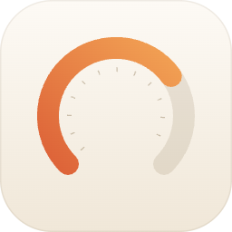
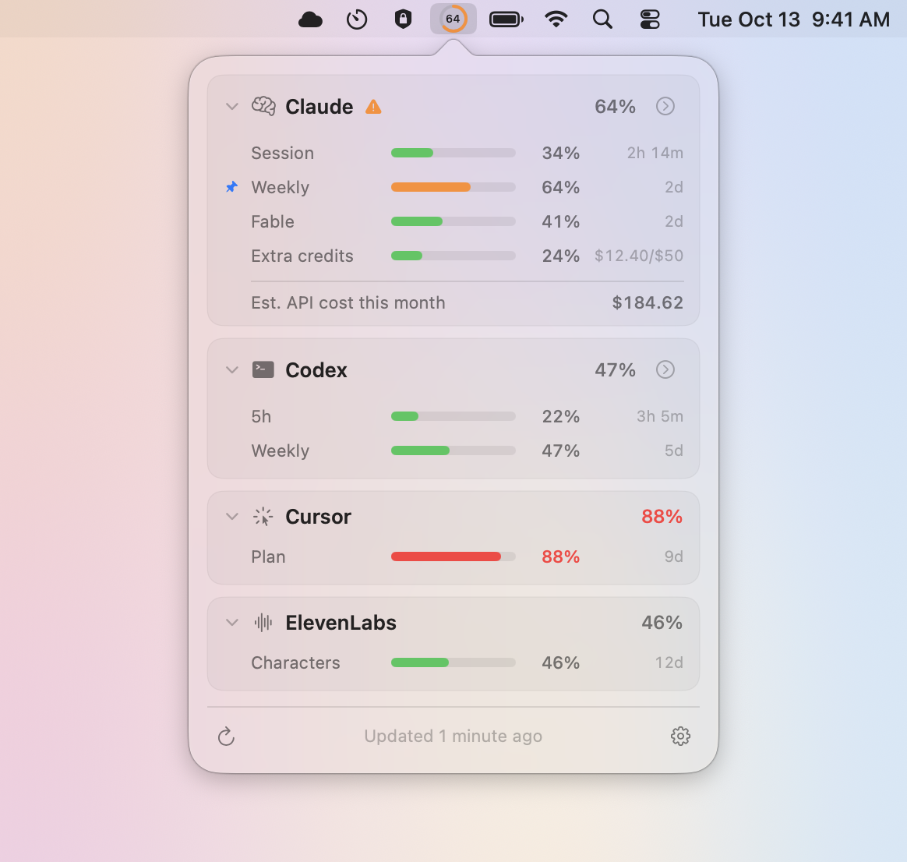
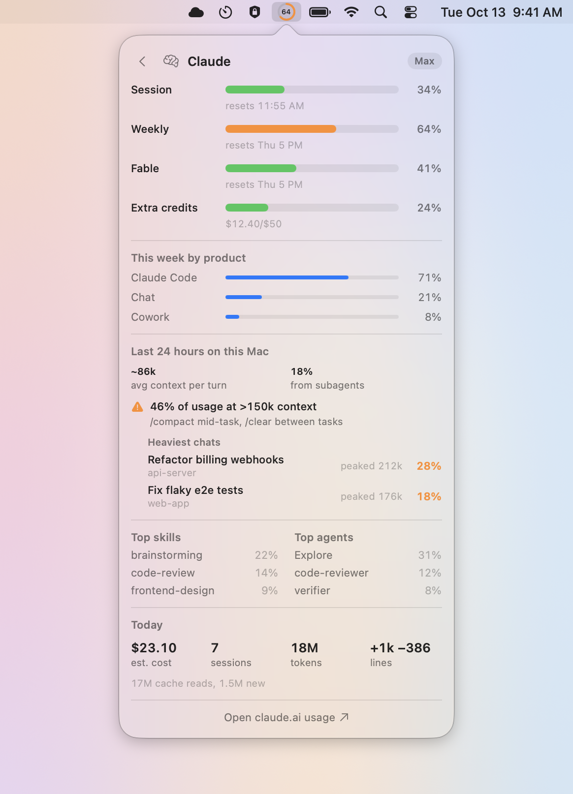
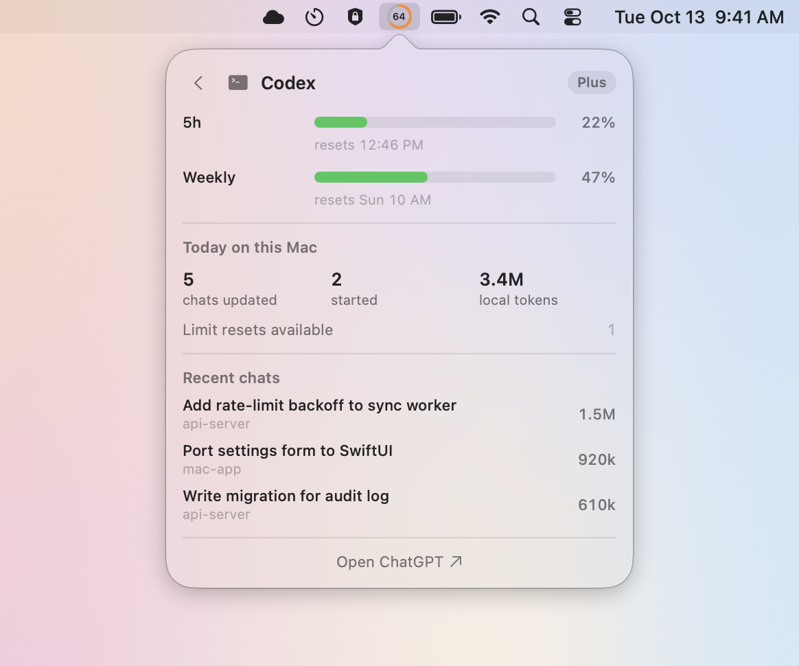
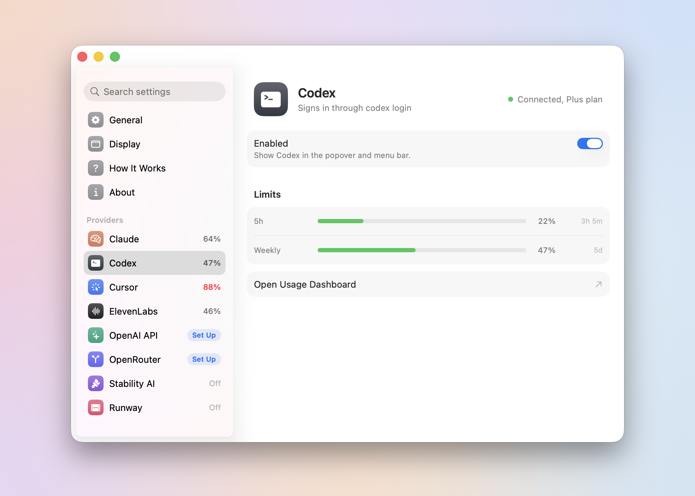

<div align="center">



# UsageTracker

**All your AI usage limits in the macOS menu bar.**<br>
See how much of each limit you've used, and when it resets, before you run out mid-task.

Claude · Codex · Cursor · OpenAI · ElevenLabs · OpenRouter

[](https://github.com/MrKaminskiy/UsageTracker/releases/latest)
[](#install)
[](LICENSE)

<br>

<picture>
  <source media="(prefers-color-scheme: dark)" srcset="docs/images/popover-dark.png">
  
</picture>

</div>

## Why

AI tools cut you off at limits you can't see: a five-hour session cap, a weekly cap, a cap per model, a monthly plan. You usually find out when a request fails.

UsageTracker puts one ring in your menu bar that fills as you use a limit. Click it to see every limit across your tools, with a countdown to each reset.

## Features

- **One ring for everything.** The menu bar shows your highest limit, or the one you pin. It turns orange at 60% and red at 85%.
- **Every limit, with its reset time.** Session, weekly, per-model caps (like Fable), extra credits, and plan quotas.
- **Pin what matters.** Click any limit in the popover to show it in the menu bar.
- **Claude and Codex detail pages.** See your plan, exact reset times, today's activity, and for Claude, usage by product this week.
- **Why you're burning through limits.** Claude insights flag usage at large context sizes, name the chats that caused it, and rank your top skills and subagents.
- **Large-context alert.** Get a notification when the Claude chat you're in passes 150k tokens of context (you can change the threshold), so you can `/compact` before it eats your session.
- **No setup for most people.** Claude Code, Codex and Cursor are picked up from the logins you already have. There's no keychain password prompt.

<table>
  <tr>
    <td width="50%" valign="top">
      <picture>
        <source media="(prefers-color-scheme: dark)" srcset="docs/images/claude-detail-dark.png">
        
      </picture>
    </td>
    <td width="50%" valign="top">
      <picture>
        <source media="(prefers-color-scheme: dark)" srcset="docs/images/codex-detail-dark.png">
        
      </picture>
    </td>
  </tr>
  <tr>
    <td align="center"><sub><b>Claude details</b>: limits, insights and today's numbers</sub></td>
    <td align="center"><sub><b>Codex details</b>: limits, local activity and recent chats</sub></td>
  </tr>
</table>

## Install

1. Download **`UsageTracker.dmg`** from the [latest release](https://github.com/MrKaminskiy/UsageTracker/releases/latest).
2. Open it and drag **UsageTracker** into **Applications**.
3. Launch it. The ring appears in your menu bar, and a welcome screen walks you through the rest.

Releases are signed with a Developer ID and notarized by Apple, so Gatekeeper opens them normally. UsageTracker checks GitHub for new versions and shows updates in **Settings → About**.

**Requires macOS 14 Sonoma or later.**

## Supported providers

| Provider | What you see | How it connects |
|---|---|---|
| **Claude** | Session, weekly and per-model limits, extra credits, usage insights, optional API cost estimate | Automatic from your Claude Code login, or [a browser cookie](#using-claude-without-claude-code) |
| **Codex** | 5-hour and weekly limits, separately metered models, monthly workspace credits, banked limit resets | Automatic from `codex login` |
| **Cursor** | Plan usage and when it resets | Automatic from the Cursor app |
| **OpenAI API** | Monthly spend (admin key) or today's requests and tokens (project key) | API key in Settings |
| **ElevenLabs** | Character quota and reset time | API key in Settings |
| **OpenRouter** | Credits used, or monthly and daily spend | API key in Settings |

OpenAI, ElevenLabs and OpenRouter support is newer and less tested than Claude, Codex and Cursor. Runway and Stability AI are built in but untested, so they're off by default. You can turn them on in Settings.

## Settings

<picture>
  <source media="(prefers-color-scheme: dark)" srcset="docs/images/settings-dark.png">
  
</picture>

Each provider has its own page with its live limits, an on/off switch, and a key field for providers that need one. Keys are checked as you paste them. Search filters the sidebar to the right page, and you can drag providers in the sidebar to reorder the popover.

### Using Claude without Claude Code

If you only use Claude in the browser or the desktop app, connect it with your claude.ai session instead:

1. Open [claude.ai](https://claude.ai) while signed in.
2. Open DevTools → **Application** → **Cookies** → `claude.ai`, and copy the `sessionKey` value.
3. Paste it into **Settings → Claude → Browser Cookie** and click **Save**.

Limits, extra credits and reset times all work this way. Insights and the cost estimate don't, because they come from Claude Code's local session logs. The cookie expires with your browser session, and UsageTracker tells you when it needs a new one.

When you're also signed in to Claude Code, the cookie only fills in for the account it belongs to, so one account's numbers never show on another account's card.

### Two Claude accounts

Give each subscription its own Claude Code config folder, and both stay signed in at once. UsageTracker finds every signed-in `~/.claude*` folder and shows each account as its own card, with its own detail page and Settings page.

```bash
mkdir ~/.claude-2
# Share your rules, settings, plugins, skills and memory with the second folder
for f in CLAUDE.md settings.json agents hooks plugins skills projects; do ln -s ~/.claude/$f ~/.claude-2/$f; done
echo "alias claude2='CLAUDE_CONFIG_DIR=\$HOME/.claude-2 claude'" >> ~/.zshrc && source ~/.zshrc
claude2   # then run /login with the second account
```

- **Card names.** With two or more accounts, cards are titled `Claude · <email>`. Rename an account in **Settings → its Claude page → Name**.
- **Idle accounts.** An account you haven't used in Claude Code for a while keeps showing its last numbers, marked `as of 9h ago`. Limits that have reset since show `reset`. UsageTracker never refreshes Claude Code's login itself, so the numbers update the next time you run Claude Code with that account.
- **Shared stats.** The cost estimate and insights come from local session logs, which don't record the account, so they appear once, labeled `all accounts`.

## Tips

- **Left-click** the ring for the popover. **Right-click** it for Settings, Clear Cache and Quit.
- **Click a limit** to pin it to the menu bar. Click it again to go back to showing your highest limit.
- **Click the circled ›** at the right of the Claude or Codex card to open its detail page.
- **Keep the refresh interval at 5 minutes or more.** Claude rate-limits frequent checks, and a rate-limited Claude card can look like it's signed out.
- **Turn on the API cost estimate** in **Settings → Display** to see what this month's Claude Code usage would cost at API prices. It's a rough estimate from local logs, not billing data.

## Privacy

UsageTracker has no account, no server and no analytics.

- It uses logins that are already on your Mac: Claude Code's (read-only from the keychain, or from `~/.claude/.credentials.json`, which it updates if it has to refresh an expired token), Codex's `~/.codex/auth.json`, and the Cursor app's local data.
- It sends requests only to the services you've connected, using your own credentials, and to the GitHub API to check for updates.
- Insights are worked out on your Mac from Claude Code's session logs and Codex's local database. They're never uploaded.
- Settings, API keys and the Claude cookie are stored in `~/.usagetracker/`. Key and cookie files are readable only by your user account.

## Troubleshooting

<details>
<summary><b>Claude is missing, shows no data, or says "Can't reach the service"</b></summary>

Claude's usage endpoint rate-limits frequent requests, and a block can last a while. Set **Settings → General → Refresh Interval** to 5 minutes or more, then wait. UsageTracker keeps showing your last reading and retries on its own.
</details>

<details>
<summary><b>How do I remove a saved API key or cookie?</b></summary>

Settings can't remove one yet. Delete its file in `~/.usagetracker/` (`claude-web.json`, `openai.json`, `elevenlabs.json` or `openrouter.json`), or turn the provider off in Settings.
</details>

<details>
<summary><b>How accurate is the cost estimate?</b></summary>

It counts the tokens in `~/.claude/projects/` and prices them at public API rates. It only covers Claude Code on this Mac, so it doesn't include claude.ai chats or API usage from other tools.
</details>

## Build from source

```bash
git clone https://github.com/MrKaminskiy/UsageTracker
cd UsageTracker
make run     # build and launch a debug build
make test    # run the test suite
```

Requires Xcode 16 or later. `make install` builds a signed release copy into `/Applications`. It needs a Developer ID certificate set in `CODESIGN_IDENTITY`.

Issues and pull requests are welcome.

## License

[MIT](LICENSE) © Kaminskiy Nikita
